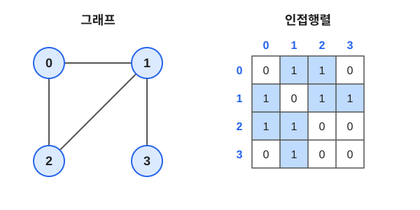
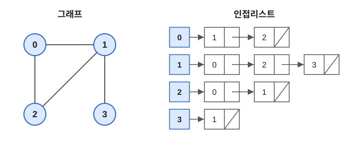

# Algorithm

## 그래프

### 비가중치 무방향 그래프
**표현**
- 인접행렬

  

- 인접리스트

  

01_birus.c: https://oj.tgthetop.synology.me/problem.php?cid=1004&pid=26

**BFS문제 유형 풀이**
1. 시작점을 큐에 넣고, 방문 표시
2. 큐에 정점이 있는 동안 반복
  2-1. 큐에서 정점을 꺼냄
  2-2. 꺼낸 점점과 연결된 정점을 찾아 방문하지 않은 정점을 큐에 넣고 방문 표시

문제
- 바이러스: https://oj.tgthetop.synology.me/problem.php?cid=1004&pid=26
- 단지번호 붙이기: 
- 등산로 찾기 #어려움: 

### 가중치 방향 그래프

문제의 유형을 찾아내는 연습하기 AI와 
BFS : 원형으로 커지는 모양
- 인접, 최단거리 이동
- 요구사항
  1. 시작점 (1개 or 여러개(1개씩 or 동시에))
  2. 인접점 (연결된 정점)
  3. 끝점 (1개 or 모든 연결된 정점)
  4. 방문표시: (0, 1)로 한번 방문된 곳은 다시 방문하지 않도록 하기,
                비용을 표시해서 더 낮은 비용으로 이동을 가능하도록 하기
  5. BFS함수를 1번 실행, 여러번 실행 (방문 표시 초기화 or 유지)
  6. q의 크기 계산 - C한정

- 문제
  - 로봇 #1006
  - 저글링 방능 오염
  - 토마토 (고)
  - 등산로 찾기
  - 단지번호 붙이기